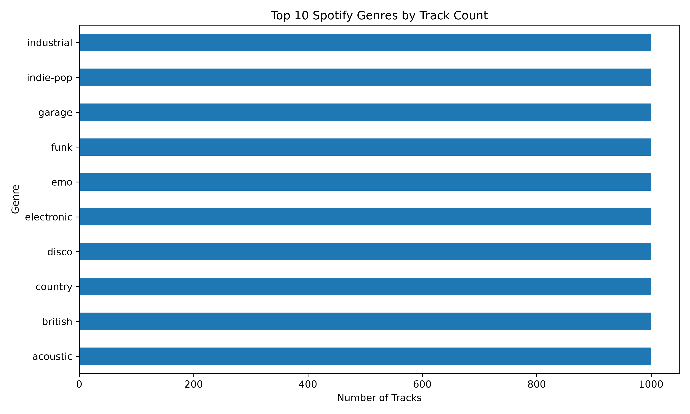
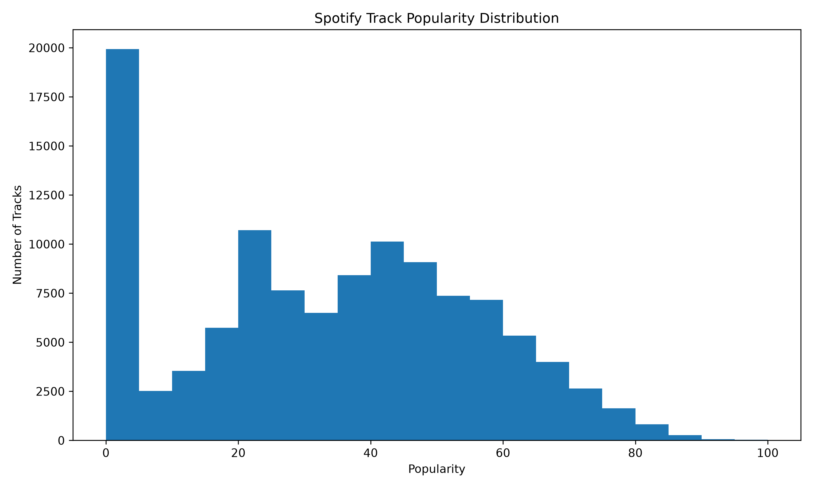
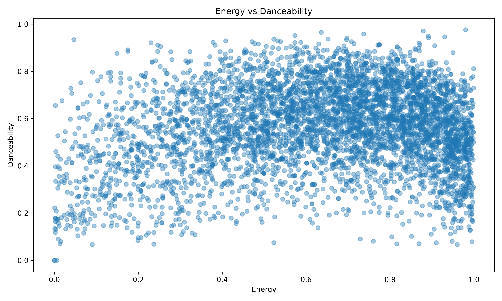
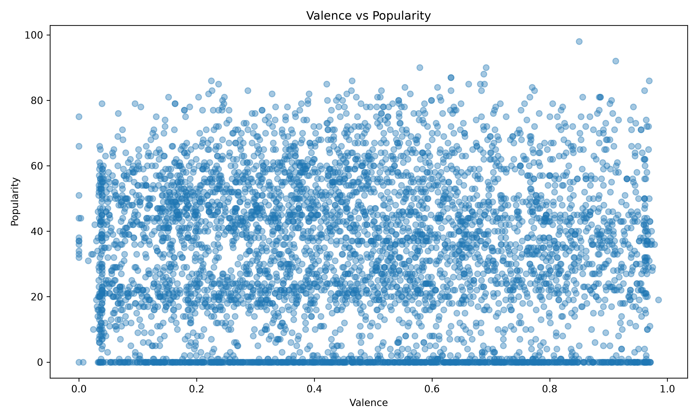

<div align="center">

# 🎧 Spotify Music Analytics

### Turning 114,000 Spotify tracks into clear, data-driven insights

An end-to-end data analysis project using **Python, SQL, Excel, and Power BI** to explore track popularity, genres, artists, and audio features.

[Explore the repository](https://github.com/basireddyzughnesh-cmyk/Spotify_Data_Analysis) · [Open the Power BI dashboard](Power%20BI/SPOTIFY%20DASHBOARD.pbix)

</div>

---

## 📌 Project at a glance

| | |
|---|---|
| **Goal** | Explore patterns in Spotify track metadata and communicate useful findings |
| **Dataset** | 114,000 source rows and 20 fields |
| **Tools** | Python (pandas, Matplotlib), SQLite, SQL, Excel, Power BI |
| **Workflow** | Data checks → cleaning → exploration → SQL analysis → reporting |

## 💡 The questions behind the analysis

- Which genres and artists appear most often in this dataset?
- How does track popularity vary across tracks and genres?
- What do the audio features—such as energy, danceability, and valence—look like?
- How many tracks are marked explicit?
- How can these findings be summarized in charts and reports?

> **Important:** These are descriptive findings about this dataset. They do not prove that a particular audio feature causes popularity, or predict future listening trends.

## 📊 Snapshot of findings

The current analysis reports:

| Finding | Result |
|---|---:|
| Tracks after duplicate removal | 113,550 |
| Average popularity score | 33.32 / 100 |
| Most represented genre | acoustic — 1,000 tracks |
| Highest average genre popularity | pop-film — 59.28 |
| Average energy | 0.642 |
| Average danceability | 0.567 |
| Tracks marked explicit | 9,718 (8.56%) |

Popularity is the score included in the source data; these results describe the dataset as supplied and cleaned for this project.

## 📈 Charts

Charts are generated in `Output/Charts/`. A few examples:

| Genre counts | Popularity distribution |
|---|---|
|  |  |

| Energy and danceability | Valence and popularity |
|---|---|
|  |  |

## 🧭 How the project works

The numbered Python scripts are intended to run in order. Each step prepares outputs used by later steps.

| Step | Script | What it does |
|---:|---|---|
| 1 | `Python/01_data_check.py` | Checks the raw file’s size, columns, data types, missing values, and duplicates. |
| 2 | `Python/02_data_cleaning.py` | Standardizes columns, removes duplicate rows, handles missing values, checks ranges, and saves a cleaned CSV. |
| 3 | `Python/03_eda.py` | Creates charts showing distributions and relationships in the data. |
| 4 | `Python/04_insights.py` | Writes a simple text summary of key measures. |
| 5 | `Python/05_create_database.py` | Loads the cleaned data into a SQLite database and checks the imported records. |
| 6 | `Python/06_run_business_queries.py` | Runs the business SQL queries and exports their results to an Excel workbook. |

### The analyst's workflow

1. **Start with questions.** Decide what needs to be understood before choosing charts or calculations.
2. **Check data quality.** Inspect the raw file before relying on its contents.
3. **Clean consistently.** Make data types, missing values, and duplicate handling explicit.
4. **Explore before concluding.** Use summaries and charts to spot patterns worth investigating.
5. **Use SQL for repeatable answers.** Keep business questions in query files that can be run again.
6. **Communicate with context.** Share the result, explain what it measures, and avoid claiming causation from simple comparisons.

## 🗂️ Project structure

```text
Spotify_Data_Analysis/
├── Data/       # Source CSV
├── Python/     # Data checks, cleaning, charts, insights, and database scripts
├── SQL/        # Database schema and analysis queries
├── Output/     # Clean data, reports, charts, and Excel results
└── Power BI/   # Interactive dashboard
```

### Main deliverables

- `Output/spotify_cleaned.csv` — dataset produced by the cleaning step
- `Output/data_check.txt` — raw-data quality report
- `Output/data_summary.csv` — compact cleaning summary
- `Output/insights.txt` — text summary of selected measures
- `Output/Charts/` — exported charts
- `Output/SQL_Business_Results.xlsx` — query results, one worksheet per query
- `SQL/spotify_analysis.db` — SQLite database created from the cleaned data
- `Power BI/SPOTIFY DASHBOARD.pbix` — Power BI dashboard file

## 🚀 Run it yourself

### 1. Get the project

```bash
git clone https://github.com/basireddyzughnesh-cmyk/Spotify_Data_Analysis.git
cd Spotify_Data_Analysis
```

### 2. Install Python dependencies

Use Python 3 and install the libraries used by the scripts:

```bash
python -m pip install pandas matplotlib openpyxl
```

`sqlite3` is included with Python. Excel export also requires `openpyxl`.

### 3. Run the analysis

Run each command from the project root:

```bash
python Python/01_data_check.py
python Python/02_data_cleaning.py
python Python/03_eda.py
python Python/04_insights.py
python Python/05_create_database.py
python Python/06_run_business_queries.py
```

The project uses paths relative to its own folders, so it does not require editing paths when cloned.

## 🧰 SQL files

- `SQL/01_create_database.sql` — table and index definitions
- `SQL/02_data_exploration.sql` — descriptive checks and summaries
- `SQL/03_business_queries.sql` — business-oriented analysis queries

The Python database script creates and loads the SQLite table from the cleaned CSV. Run the Python pipeline above first to make sure the database and output files are up to date.

## ⚠️ Notes and interpretation

- Duplicate removal leaves **113,550 rows** from **114,000 source rows**.
- The dataset has nearly 1,000 tracks for many genres. A genre’s average popularity should be interpreted alongside its track count.
- Popularity is a dataset-provided measure and can change over time or depend on how the source was collected.
- The average values and comparisons are descriptive; they should not be read as causal relationships.
- The included Power BI file can be opened with Power BI Desktop. The Python workflow does not generate or refresh the `.pbix` file.

## 🛠️ Tools

`Python` · `pandas` · `Matplotlib` · `SQL` · `SQLite` · `Excel` · `Power BI`

---

<div align="center">

**Built to demonstrate a practical analytics workflow—from raw data to stakeholder-ready reporting.**

</div>
